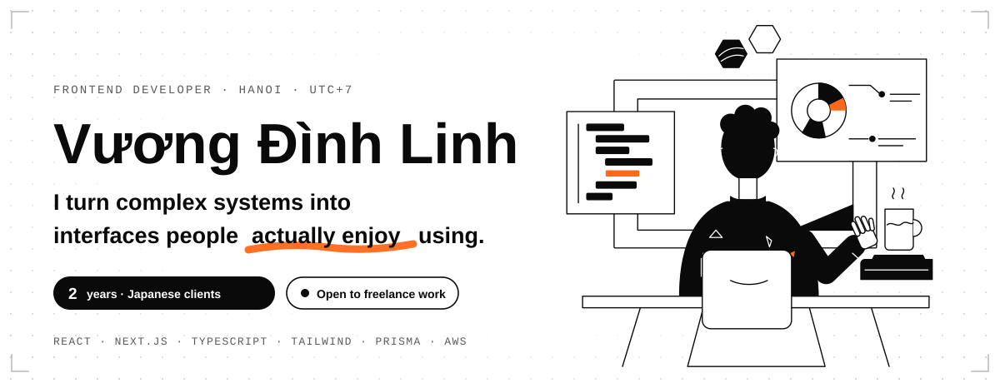

  <a href="https://portfolio-linhdev.vercel.app">
    <picture>
      <source media="(prefers-color-scheme: dark)" srcset="assets/banner-dark.svg">
      
    </picture>
  </a>

  <picture>
    <source media="(prefers-color-scheme: dark)" srcset="assets/rotator-dark.svg">
    
  </picture>

 

I'm **Linh**, a frontend developer in Hanoi. Since 2024 I've worked at **VAiX Group**, building web apps for Japanese clients. Most of them aren't flashy products: they're the systems a business runs on — orders, stock, quotes, schedules, site records.

I started on the frontend, then took the backend on one project too: the FedEx and eBay integrations, the database move and the deployment. I like owning a feature from the screen to the database, and I don't call it done until there's a test report.

**Portfolio →** [portfolio-linhdev.vercel.app](https://portfolio-linhdev.vercel.app) &nbsp;·&nbsp; available in English and Tiếng Việt.

  <picture>
    <source media="(prefers-color-scheme: dark)" srcset="assets/divider-dark.svg">
    
  </picture>

## What I build

| | |
|---|---|
| **Project management apps** | Job tracking, schedules, approvals and reports for teams that work across offices and sites. |
| **Food ordering and menu management** | Menus, carts and checkout for customers, plus the back-office screens staff use to keep it running. |
| **SaaS products** | Multi-role web apps with accounts, permissions, data import and more than one language. |
| **APIs and backend** | Third-party integrations such as eBay and FedEx, OAuth, Prisma and MySQL, deployed with Docker and AWS. |

## Selected work

Client and product names stay private, so these are described by what they do.

- **An online store where buyers configure their own equipment** — a Japanese/English store with a 7-step configurator, a bill of materials with live prices, and about 100 test files. `Next.js 16` `React 19` `TypeScript` `Tailwind v4` `Zustand` `Vitest`
- **Fulfillment for cross-border eBay sellers** — sellers ship stock to a warehouse; the system pulls eBay orders and prints FedEx labels. `Next.js 14` `Prisma` `MySQL` `AWS S3` `Docker`
- **One place for a construction company's daily work** — jobsite records, quotes, timesheets and crew scheduling in one cloud system. `React 18` `Redux Toolkit` `React Query` `i18next`
- **Managing repair jobs on site, on tablet, desktop and phone** — a work-order system built by a team of about six. `React 19` `Vite` `TanStack Query` `Storybook`
- **A food ordering app** — in progress, layout first and ordering logic next.

## Toolbox

  <picture>
    <source media="(prefers-color-scheme: dark)" srcset="assets/toolbox-dark.svg">
    
  </picture>

## How I work

1. **Figma to React, checked twice.** I connect Figma to code through MCP, build the interface from the design, then compare the result with the design to see how closely it matches.
2. **AI inside the workflow.** Skills and hooks I wrote take an issue through analysis, implementation, tests and retest, then commit, open the PR and update the task.
3. **Tests are part of the job.** Vitest and mutation tests; on one project a script compares the drawings and bill of materials with the reference, so a changed price or part can't slip through.

  <picture>
    <source media="(prefers-color-scheme: dark)" srcset="assets/divider-dark.svg">
    
  </picture>

## Let's talk

I'm open to freelance projects: project management, food ordering and SaaS. Tell me what you're working on, any time. I'm in Hanoi (UTC+7).

**Portfolio** [portfolio-linhdev.vercel.app](https://portfolio-linhdev.vercel.app) · **Email** [linhdev297@gmail.com](mailto:linhdev297@gmail.com) · **LinkedIn** [linh-dinh](https://www.linkedin.com/in/linh-dinh-a55905443) · **GitHub** [linhdev29](https://github.com/linhdev29)
